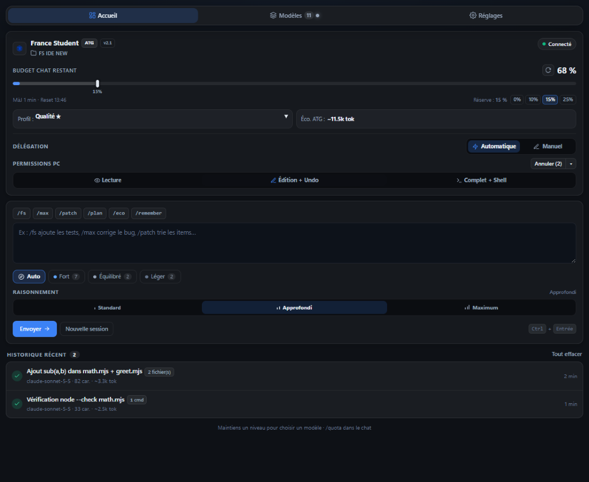
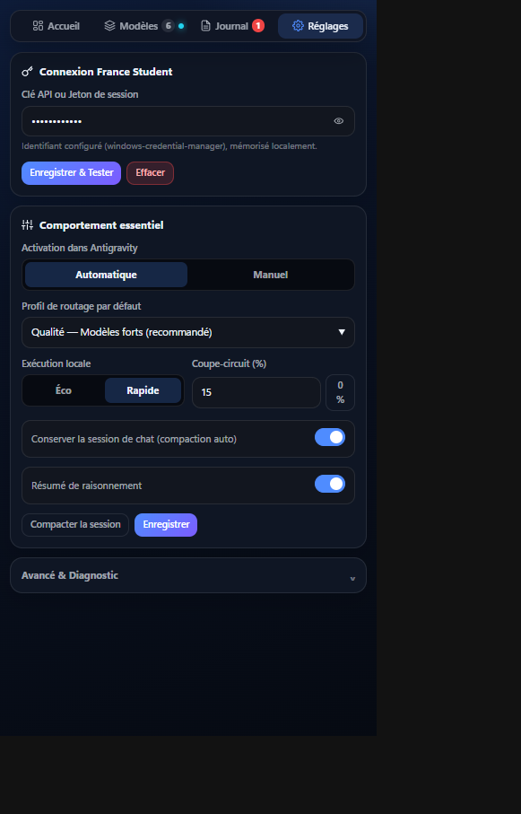

# France Student pour Antigravity (`fs-atg` v1.0.0)

Plugin Antigravity (panneau latéral + serveur MCP) pour déléguer plans, diagnostics, recherches multi-sources et blocs de code ciblés aux **14 modèles France Student**, en mode **lecture seule sur le PC**.

## Aperçu

| Accueil (Jauge unique, Auto/Manuel & Profil) | Modèles (14 modèles FS, date & badge Nouveau) |
| :---: | :---: |
|  |  |

| Journal de bord (`fs_logs`) | Réglages |
| :---: | :---: |
|  |  |

## Nouveautés & fonctionnalités clés

- **Jauge unique interactive (`Accueil`)** : une seule barre regroupe le **budget chat restant** (bleu/noir, sans violet) et le **curseur du coupe-circuit** déplaçable directement à la souris ou au clavier (`0`–`90 %`, raccourcis `0%` `10%` `15%` `25%`), avec sélecteur de profil et mode `Auto / Manuel` sur la même vue.
- **14 modèles France Student uniquement** : catalogue synchronisé avec `/v1/models` (ID copiable, date d'ajout réelle et badge `Nouveau` < 14 jours) ; priorité aux modèles fiables et **bascule automatique vers Claude (`claude-sonnet-5-5`)** si un modèle tente une redirection `create_artifact` sans code inline.
- **Prompts & réponses ultra-compacts** : consignes sans texte superflu ni commentaires inutiles, plans télégraphiques en 15 lignes max, et calcul d'économie nette réaliste dans `Éco. ATG` (qui déduit le coût de lecture côté Antigravity).
- **Lecture seule sur le PC** : France Student n'écrit jamais sur le disque ; il renvoie le résultat dans `response`.
- **Plan A + Plan B** : réessai automatique sur session isolée ou découpage en petits blocs (`planB: true`, `parts: [...]`).
- **Journal de bord (`fs_logs`)** : logs rotatifs filtrables conservant les compteurs numériques `usage` tout en masquant clés API et jetons.

## Commandes `/` disponibles dans Antigravity

| Commande | Action / Routage | Objectif économie Antigravity |
|---|---|---|
| `/patch` | `executionMode="patch"` + lecture `files` côté MCP | Renvoie uniquement des paires `TARGET` / `REPLACE` pour `edit_file` (**-52 % à -70 %** mesurés) |
| `/plan` | `executionMode="plan"` (≤ 15 lignes) | Plan télégraphique sans code ni écriture disque |
| `/eco`, `/fast`, `/low` | `claude-haiku-5-5` / modèles rapides (< 15 s) | Finir en **1 seul appel MCP**, moitié moins de texte lu par Antigravity |
| `/medium` | `claude-sonnet-5-5` prioritaire | Code inline dense sans redirection `create_artifact` |
| `/high` | Gamme forte (`opus`, `gpt-6.2-astra`, `gpt-6.2-sol`) | Architecture, audits, debug ou logique complexe |
| `/send`, `/dry-run` | Délégation directe / aperçu sans écriture | Blocs ciblés ou proposition à valider (`files` lus côté MCP) |
| `/new`, `/compact` | Session persistante France Student (`fs_session`) | Repartir à zéro ou compacter le contexte côté France Student (`/usage` & `/compact` côté Antigravity) |
| `/diagnostics`, `/logs` | Lecture seule état & journal rotatif (`fs_logs`) | Contrôle clé/API/modèles/quota et suivi d'erreurs |

## Quand gagne-t-on vraiment du quota Antigravity ? (expliqué simplement)

`fs-atg` fonctionne en **lecture seule sur le PC** : France Student fait le gros du travail, puis renvoie le résultat à Antigravity. **Plus la réponse est courte et ciblée, plus tu économises Antigravity.**

| Ce que tu demandes / commandes | Tu gagnes ? | Pourquoi & combien concrètement (mesuré en test) |
|---|---|---|
| **`/patch`** *(modifier juste un bout d'un fichier existant)* | **OUI — Énorme gain** | Au lieu de réécrire tout le fichier (`7 273` car.), France Student renvoie juste les **`371` car.** à changer (**`-94,9 %`** à écrire ; **`-52,2 %`** sur un petit fichier de ~150 lignes). |
| **`/plan`** *(cadrer avant de toucher aux fichiers)* | **OUI — Gros gain** | Antigravity reçoit juste un résumé clair en **8 à 19 lignes** (**8 à 16 s**) au lieu de réfléchir et fouiller tes dossiers tout seul. |
| **Discuter dans le panneau latéral France Student** | **OUI — Gain 100 %** | Tant que tu échanges dans le panneau, **Antigravity ne travaille pas = `0` quota utilisé**. |
| **`/eco` ou `/low`** *(petite question, petite fonction, bug rapide)* | **OUI — Gros gain** | Répond en **5 à 8 s** et très court (**`433` à `683` car.**), soit environ **2× moins de texte à lire** pour Antigravity qu'un gros modèle (`1 487` car.). |
| **`/medium`** *(fonction moyenne, bout de CSS/JS propre)* | **OUI — Bon gain** | Répond en **6 à 14 s** sans bavardage (**`~800` à `2 300` car.**) sans redirection d'artefact. |
| **`/high`** *(gros problème, comparaison, analyse compliquée)* | **OUI — Gros gain** | La grosse réflexion se fait côté France Student (**22 s**, tableau comparatif complet en **`2 478` car.**). |
| **Donner les fichiers directement à France Student (`files`)** | **OUI — Gain moyen** | France Student lit lui-même jusqu'à **6 fichiers (`24 000` car. max)** sans qu'Antigravity ait besoin de les ouvrir un par un avant. |
| **`/compact` (Antigravity) / `/new` (France Student)** | **OUI — Bonus malin** | Nettoie la mémoire quand le fil devient long pour que les prochains messages coûtent moins cher. |
| **Créer un gros fichier tout neuf de A à Z** | **NON — `0 %` d'économie** | France Student génère la page (`24 149` car. sur la calculatrice 3D), mais comme il ne peut pas écrire sur disque, **Antigravity doit tout réécrire mot pour mot** via `write_file`. |
| **Faire 1 petite recherche web rapide** | **NON — `~0 %` d'économie** | `search_web` natif prend **1 étape**, passer par France Student prend aussi **1 étape**. |
| **Changer moins de 10 lignes juste sous ses yeux** | **NON — Perte nette** | Corriger direct coûte moins cher qu'un aller-retour vers France Student + correction. |

La mesure officielle de consommation Antigravity reste accessible directement via `/usage`.

## Exemples concrets (4 cas réels testés)

### 1. Créer une calculatrice 3D complète de A à Z (`0 %` d'économie de quota)
- **Antigravity seul** : génère et écrit directement `7 273` car. en 1 étape.
- **Via France Student (`Plan B`)** : génère une version plus complète de `24 149` car. (`15 989` tokens côté France Student), **mais** comme `fs-atg` n'écrit pas sur le disque, Antigravity doit ensuite tout recopier via `write_file` — ce qui annule l'économie de quota Antigravity.

| Antigravity natif (`7 273` car.) | France Student `Plan B` (`24 149` car.) |
| :---: | :---: |
|  |  |

### 2. Modifier une page existante avec `/patch` (**`-94,9 %`** à écrire)
- **Demande** : ajouter un raccourci clavier sur la calculatrice de `7 273` car.
- **Résultat** : France Student lit le fichier lui-même et ne renvoie que **`371` car.** (`1` appel en `27,95 s`). Antigravity n'a presque rien à lire ni à réécrire.

### 3. Préparer un plan avant de coder avec `/plan` (**19 lignes**, `0` fichier touché)
- **Demande** : plan pour ajouter un historique persistant avec recherche et export JSON.
- **Résultat** : résumé structuré en **`19` lignes** (`1 855` car., `16,2 s`) sans que Antigravity explore tous tes dossiers.

### 4. Écrire une petite fonction utilitaire avec `/eco` (`5–8 s`, **433 car.**)
- **Demande** : fonction `formatBytes` en JavaScript.
- **Résultat** : `claude-haiku-5-5` répond en **`7,99 s`** et **`433` car.** (`1` seul aller-retour, ~2× moins de texte à lire qu'un gros modèle).

### 5. Faire 1 petite recherche web rapide (`~0 %` d'économie → garder en natif)
- **Demande** : trouver le Top 3 des modèles IA du moment.
- **Résultat** : `search_web` natif prend **1 étape**, passer par France Student prend aussi **1 étape**. Aucun intérêt à déléguer une recherche simple.

## Installation rapide

```bash
git clone https://github.com/pierregdc/fs-atg.git
cd fs-atg
node install.mjs
```

Rechargez Antigravity, ouvrez **France Student [ATG]** et renseignez votre clé API ou jeton de session dans **Réglages**.
