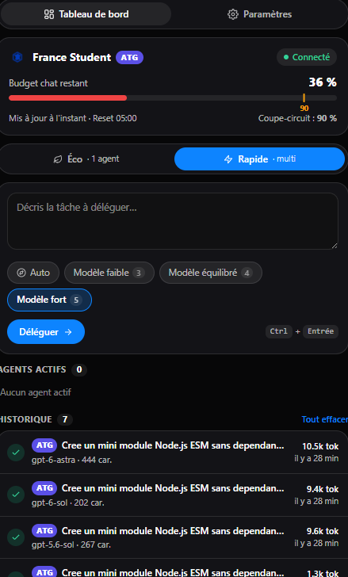

# France Student pour Antigravity (`fs-atg`)

Extension IDE (`.vsix`) et plugin Antigravity (panneau latéral + serveur MCP + règle par défaut) pour déléguer la génération de code aux modèles **France Student** (ChatGPT & Claude).

## Aperçu

| Tableau de bord | Paramètres |
| :---: | :---: |
|  |  |

## Installation rapide (Antigravity)

```bash
git clone https://github.com/pierregdc/fs-atg.git
```

1. Copiez le dossier `plugin/` dans `~/.gemini/config/plugins/fs-atg/`.
2. Installez les dépendances MCP :
   ```bash
   cd ~/.gemini/config/plugins/fs-atg && npm install
   ```
3. Rechargez Antigravity, ouvrez **Extensions > France Student [ATG]**, puis dans **Paramètres** collez votre **clé API** (ou votre cookie `next-auth.session-token` de `ia.francestudent.org` en attendant l'accès développeur).

<details>
<summary>Optionnel : installer aussi l'extension .vsix dans Antigravity IDE / VS Code</summary>

```bash
npm install && npm run build
npx @vscode/vsce package --allow-missing-repository
```
Installez ensuite le `.vsix` généré via **Extensions → Install from VSIX…**.

</details>

## Gains estimés (honnêtes)

- **Contexte & quota de l'agent principal** : les fichiers générés sont écrits directement sur disque (`clientTools`) sans repasser par la conversation principale — économie importante de contexte sur les tâches multi-fichiers ou de > 30 lignes.
- **Consommation réelle** : la génération consomme malgré tout votre **quota France Student** (d'où le coupe-circuit configurable, défaut `15 %`).
- **Routage à 0 token** : le choix `Modèle faible` / `Modèle équilibré` / `Modèle fort` est 100 % local (aucun appel API de tri).
- **Compaction intégrée** : les suites de tâches (`parentJobId`) ne transmettent que le résumé du job précédent, pas le code complet.

## Fonctionnalités clés

- **Double mode** : Clé API (`/v1/responses`) ou `sessionToken` (`/chats/stream` + `clientTools`).
- **Modèles pré-enregistrés** : 12 modèles ChatGPT & Claude classés en *Faible* / *Équilibré* / *Fort* (survol pour voir ou forcer un modèle).
- **Historique clair** : `✓` fichiers écrits, `!` terminé sans écriture, `✕` erreur.
- **Sécurité** : accès limité au workspace (`.git/` et `.env*` bloqués, sans exécution shell par défaut).
