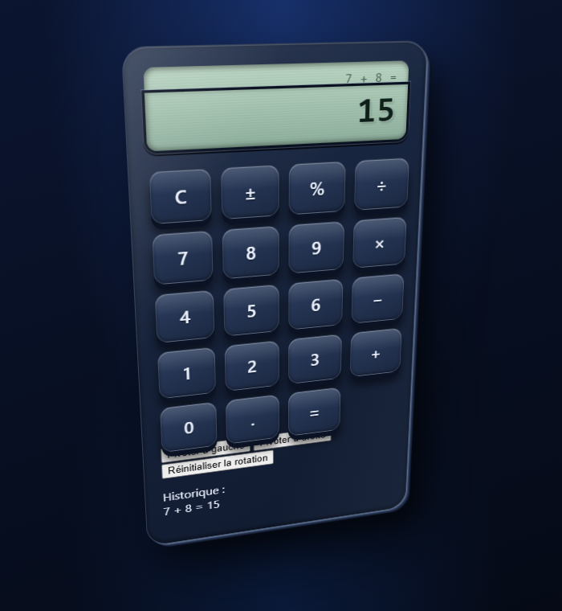
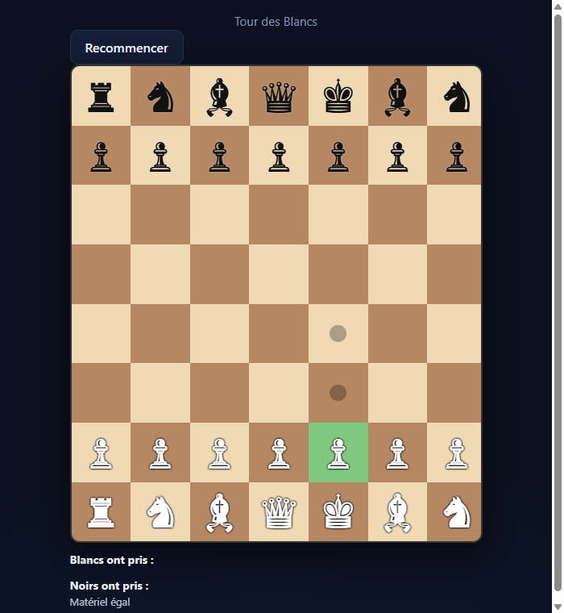

<p align="center">
  <picture>
    <source media="(prefers-color-scheme: dark)" srcset="docs/images/logo-dark.svg">
    <source media="(prefers-color-scheme: light)" srcset="docs/images/logo-light.svg">
    
  </picture>
</p>

<h1 align="center">France Student pour Antigravity (<code>fs-atg</code> v2.5.0)</h1>

<p align="center">
  <strong>Orchestrateur France Student &amp; serveur MCP <code>stdio</code> (24 outils + Hub de 34 connecteurs MCP + Suite IA Classique) pour Antigravity</strong><br>
  Exécution autonome sur le workspace, Suite IA Classique (Code Interpreter <code>/data</code>, Deep Research <code>/research</code>, Live Canvas <code>/canvas</code>, Vision OCR <code>/vision</code>, Consensus Multi-IA <code>/arena</code>, Lecteur PDF/Office <code>/doc</code>, Voix TTS <code>/voice</code>, Watchers <code>/watch</code>), Hub 34+ MCP (Roblox Studio, Blender, Unity, DB, DevOps…), Computer Use (<code>/computer</code>) et Navigateur CDP (<code>/browse</code>).
</p>

<p align="center">
  <a href="plugin/plugin.json"></a>
  <a href="LICENSE"></a>
  <a href="#commandes-slash-officielles"></a>
  <a href="#nouveautes-v25--suite-ia-classique-8-outils-integres"></a>
</p>

---

## Aperçu de l'interface

L'interface du panneau latéral adopte un thème monochrome/slate et bleu unifié sans surcharge visuelle, structuré en **3 onglets principaux** (**Accueil**, **Modèles**, **Réglages**) avec indicateurs clarifiés : pastilles de gamme (`Fort`, `Équilibré`, `Léger`), badge émeraude `Nouveau` (< 14 jours), barres d'intensité du raisonnement et sélecteur d'autorisation par modèle.

| Accueil (jauge unique, permissions &amp; raisonnement) | Modèles (contrôle Oui / À demander / Non &amp; badges) |
| :---: | :---: |
|  |  |

| Réglages (connexion &amp; comportement) | Journal &amp; Avancé (logs &amp; diagnostics) |
| :---: | :---: |
|  |  |

---

## Nouveautés v2.5 — Suite IA Classique (8 outils intégrés)

1. **`fs_data` (`/data` — Code Interpreter, Data Analyst &amp; Graphiques SVG)** : profilage statistique complet de fichiers `.csv`, `.tsv`, `.json`, `.jsonl` (`profile`: types, valeurs manquantes, min/max/moyenne/médiane/écart-type, top catégories), requêtes filtrées et agrégées (`query`: `groupBy`, `sum`/`avg`/`min`/`max`, `sortBy`), génération de graphiques SVG autonomes (`chart`: `bar`, `line`) et exécution sandboxée de scripts Node.js ou Python (`run_js`, `run_python`).
2. **`fs_research` (`/research` — Deep Research Multi-Sources)** : lance plusieurs recherches web en parallèle, extrait le Markdown propre des meilleures pages, croise les informations et produit un rapport synthétique sourcé avec citations numérotées `[1]`, `[2]` via France Student.
3. **`fs_canvas` (`/canvas` — Artifacts &amp; Live Canvas Preview)** : enregistre et sert en direct des artifacts interactifs (`html`, `svg`, `mermaid`) sur un serveur HTTP local dédié (`http://127.0.0.1:<port>/<id>.html`).
4. **`fs_vision` (`/vision` — Vision &amp; OCR Écran Natif Windows WinRT)** : capture l'écran ou une image locale et extrait instantanément toutes les lignes de texte visibles grâce au moteur OCR natif Windows (`Windows.Media.Ocr`, 100 % local et hors-ligne), ou inspecte les dimensions PNG et le hash SHA-256 (`inspect_image`).
5. **`fs_arena` (`/arena` — Consensus &amp; Comparatif Multi-Modèles)** : soumet une question complexe ou une revue critique à 2 ou 3 modèles France Student en parallèle, mesure leur latence et retourne leurs réponses côte-à-côte.
6. **`fs_doc` (`/doc` — Lecteur Universel de Documents PDF, Office &amp; ZIP)** : extrait le texte de fichiers `.pdf`, `.docx`, `.xlsx`, `.pptx`, `.odt`, `.zip`, `.md` et `.txt` (`extract`), ou découpe le document en paragraphes pour ne retourner que les `topK` passages pertinents (`search`) sans saturer la fenêtre de contexte d'Antigravity.
7. **`fs_voice` (`/voice` — Mode Vocal : Dictée &amp; Synthèse TTS Windows)** : bouton de dictée vocale (`Micro`) dans le panneau latéral et outil MCP de synthèse vocale native Windows (`System.Speech.Synthesis`) pour parler à voix haute (`speak`), générer un fichier `.wav` (`to_wav`) ou lister les voix installées (`voices`).
8. **`fs_schedule` (`/watch` — Tâches Planifiées &amp; Watchers Intelligents)** : surveille en arrière-plan un fichier (`file`), une URL (`http`) ou une commande (`command`) à intervalle régulier et déclenche une notification Windows en cas de changement.

---

## Nouveautés v2.4 — Hub MCP Universel (34 connecteurs dont Roblox Studio &amp; Blender)

- **`fs_mcp_hub` (`/mcp` — Hub &amp; Passerelle 34+ MCP)** : rend l'extension compatible avec **34 serveurs MCP et ponts applicatifs** organisés en 5 catégories, pilotables depuis Antigravity ou en 1 clic dans **Réglages -> Essentiel -> Hub MCP** :
  - **Pont natif Blender (`action="blender"`)** : exécute du code Python `bpy` directement dans Blender ouvert via le socket TCP `127.0.0.1:9876` (`blender-mcp`) ou en mode headless CLI (`blender.exe --background --python-expr`).
  - **Pont natif Roblox Studio &amp; Rojo (`action="roblox"`)** : communique avec le plugin HTTP Roblox Studio (`127.0.0.1:44755`) pour inspecter/modifier le DataModel en Luau, ou génère instantanément une architecture complète **Rojo + Luau** (`default.project.json` + `src/ServerScriptService/Main.server.luau`) via `robloxAction="scaffold_rojo"`.
  - **Passerelle JSON-RPC 2.0 `stdio` universelle (`action="tools"` / `action="call"`)** : interroge et exécute à la volée les outils de n'importe lequel des 34 serveurs MCP (`npx` / `uvx` / `docker`) avec stockage chiffré des clés API tierces dans le Trousseau système (`Windows Credential Manager` / macOS Keychain / Linux `secret-tool`).
  - **Détection locale (`action="probe"`) &amp; Export JSON (`action="export_config"`)** : détecte automatiquement les applications installées (Blender, Roblox Studio, Unity, Godot, Docker, Git, FFmpeg) et sonde leurs ports locaux (`9876`, `44755`, `8090`, `6007`, `6333`).

### Catalogue des 34 connecteurs MCP intégrés

| Catégorie | Connecteurs compatibles (`connectorId`) |
| :--- | :--- |
| **3D, Jeux &amp; Création (7)** | `blender` (Blender 3D TCP 9876 + CLI `bpy`), `roblox` (Roblox Studio HTTP 44755 + Rojo Luau), `unity` (Unity Editor Bridge 8090), `unreal` (Unreal Engine 5 Python/Remote 30010), `godot` (Godot Engine 4 GDScript 6007), `figma` (Figma Design &amp; UI), `aseprite` (Aseprite Pixel Art &amp; Sprites) |
| **Bases de données &amp; Backend (8)** | `postgres` (PostgreSQL), `sqlite` (SQLite local), `mysql` (MySQL / MariaDB), `mongodb` (MongoDB Atlas/Local), `redis` (Redis Cache &amp; Streams), `supabase` (Supabase DB/Auth/Edge), `firebase` (Firebase Firestore/Hosting), `prisma` (Prisma ORM &amp; Migrations) |
| **Code, Git &amp; Cloud DevOps (8)** | `github` (GitHub Repos/PRs/Actions), `gitlab` (GitLab Issues/MR/Pipelines), `git` (Git local), `docker` (Docker Containers &amp; Compose), `kubernetes` (Kubernetes `kubectl`), `cloudflare` (Cloudflare Workers/KV/D1/R2), `vercel` (Vercel Deployments &amp; Logs), `sentry` (Sentry Errors &amp; Stacktraces) |
| **Web, Navigateurs &amp; Média (6)** | `playwright` (Playwright E2E Browser), `puppeteer` (Puppeteer Headless Chrome), `ffmpeg` (FFmpeg Audio/Vidéo), `youtube` (YouTube Transcript &amp; Metadata), `brave-search` (Brave Web Search API), `context7` (Context7 Library Docs) |
| **Productivité &amp; Documentation (5)** | `notion` (Notion Workspace &amp; Databases), `obsidian` (Obsidian Vault Markdown), `discord` (Discord Bot &amp; Webhooks), `slack` (Slack Channels &amp; Messages), `linear` (Linear Issues &amp; Cycles) |

---

## Nouveautés v2.3 — Computer Use, Navigateur CDP, Web &amp; Système

- **`fs_computer` (`/computer` — Computer Use Windows)** : capture d'écran PNG (`screenshot`, avec protection des surfaces DirectX plein écran), topologie multi-écrans et position du curseur (`screen_info`), liste et focus des fenêtres (`windows`, `focus_window`), actions souris (`mouse_move`, `click`, `double_click`, `right_click`, `drag`, `scroll`), saisie clavier et raccourcis (`type`, `key`, `hotkey` avec blocage des combinaisons système critiques) et presse-papiers (`clipboard_get`, `clipboard_set`).
- **`fs_browser` (`/browse` — Automatisation Chrome/Edge par CDP)** : pilote Chrome ou Edge en mode headless ou visible sans dépendance externe via Chrome DevTools Protocol (`open`, `snapshot` DOM interactif compact, `screenshot`, `click`, `fill`, `press`, `scroll`, `eval`, `console`, `close`).
- **`fs_web` (`/web` — Lecture Web Markdown &amp; Recherche)** : convertit toute page ou documentation en Markdown propre sans bruit HTML (`fetch`), effectue des recherches web (`search`), et peut déléguer la lecture d'une longue documentation à France Student (`question`) pour ne renvoyer qu'une synthèse courte à Antigravity.
- **`fs_system` (Inspection Système, Processus &amp; Ports TCP)** : bilan CPU/RAM/OS (`overview`), top processus par mémoire (`processes`), propriétaires des ports TCP en écoute (`ports`) et notifications bureau (`notify`).
- **Timeout SSE glissant** : le timeout de génération se réarme à chaque frame SSE reçue et à chaque tour d'outil local.

---

## Nouveautés v2.2

- **Télémétrie par modèle (7 jours)** : mesure le débit réel (`tok/s`), le délai avant premier token (`TTFT`), le taux de succès et le nombre de replis `429/502`, affichés sur chaque carte de l'onglet **Modèles** avec alerte d'instabilité.
- **Configuration portable** : export et import JSON sans secret dans **Réglages -> Avancé** (politiques modèles, profils, permissions, seuils).
- **Cache de lecture (60 s)** : met en cache `list_directory` et `search_files`, invalidé automatiquement à chaque écriture ou commande.
- **Commande `/model <nom>`** : force un modèle précis directement depuis le prompt.
- **Diff avant `/undo`**, **jauge de contexte**, **notifications de fin de tâche (> 15 s)** et **trousseau système macOS / Linux** (`security` / `secret-tool`).
- **Optimisation gros jobs (`v2.2.1`)** : `waitSeconds` porté à `120 s` (`180 s` max), timeout stream outils à `240 s`, cooldown groupé sur saturation `openai_v2` et maintien de `clientTools` sur erreur réseau transitoire.

---

## Nouveautés v2.1

- **Connexion navigateur en 1 clic (session longue durée)** : depuis l'accueil ou **Réglages -> Essentiel**, clique sur *Se connecter avec France Student* pour ouvrir la page officielle de connexion, te connecter avec tes identifiants habituels, puis laisser l'extension chiffrer la session dans le **Trousseau Windows** (`Windows Credential Manager`) et renouveler automatiquement tes jetons d'accès (`/api/auth/api-token`) avant expiration ou sur HTTP 401. Une option repliable *Connexion manuelle* reste disponible.
- **Contrôle individuel par modèle (`Oui` / `À demander` / `Non`)** : autorise, bloque ou exige une confirmation utilisateur explicite avant qu'Antigravity ou le panneau n'utilise un modèle.
- **Interface unifiée en 3 onglets** :
  - **Accueil** : jauge unique interactive (budget chat restant + coupe-circuit réglable de 0 % à 90 %), sélecteurs compacts *Délégation* et *Permissions PC*, barre de commandes rapides (`/fs`, `/max`, `/patch`, `/plan`, `/eco`, `/remember`), sélecteur de raisonnement à 3 niveaux (*Standard*, *Approfondi*, *Maximum*) et historique détaillé avec `/undo`.
  - **Modèles** : catalogue filtrable avec fournisseur, fenêtre de contexte, date de détection, badge `Nouveau` (< 14 jours) et contrôle 3 états sur chaque carte.
  - **Réglages** : sous-onglets *Essentiel*, *Mémoire* (`FRST.md`, notes, pré-prompt) et *Journal &amp; Avancé* avec badge d'erreurs sur l'onglet.
- **Cascade de résilience 502/429 &amp; Cooldown `IA non dispo`** : en cas d'erreur HTTP 502, 503, 504 ou 429, bascule automatique du meilleur modèle au moins fort (`heavy` -> `medium` -> `light`). Si aucun modèle autorisé ne répond, un **cooldown global de 10 minutes (`IA non dispo`)** est activé pour laisser Antigravity travailler en natif sans blocage.
- **8 commandes slash officielles** déclarées dans `plugin/skills/` pour le chat Antigravity.

---

## Contrôle par modèle (Oui / À demander / Non)

Dans l'onglet **Modèles**, chaque modèle dispose d'un sélecteur persistant (`.fsatg_state.json`) qui gouverne à la fois le serveur MCP (`fs_delegate`) et les générations du panneau :

| État | Valeur | Comportement sur le routage, `fs_delegate` et la cascade 502/429 |
| :--- | :--- | :--- |
| **Oui** | `allow` | Utilisable librement par le routeur et par les replis automatiques. |
| **À demander** | `ask` | Si le modèle est choisi ou recommandé, `fs_delegate` retourne `status: "needs_approval"` avec jusqu'à 3 alternatives en `Oui` : Antigravity demande confirmation à l'utilisateur avant de relancer avec `approveModel`. Exclu des bascules silencieuses de la cascade 502/429. |
| **Non** | `deny` | Totalement exclu du routage automatique, de la cascade de secours et des sélections explicites (`Utiliser` masqué, erreur explicite en cas d'appel direct). |

---

## Commandes slash officielles

| Commande | Outil / Paramètre | Effet et économie de quota Antigravity |
| :--- | :--- | :--- |
| **`/fs`** | `fs_delegate` (`workspaceRoot`) | Délégation principale avec lecture/écriture directe sur disque et sauvegarde `/undo` ; seul un bilan court (`filesWritten`) revient à Antigravity. |
| **`/max`** | `reasoningEffort="max"` | Active le protocole de raisonnement maximal et priorise les modèles `Fort`. |
| **`/patch`** | `executionMode="patch"` | Mode lecture seule : renvoie uniquement les blocs `TARGET` / `REPLACE` à appliquer (**-94,9 %** mesurés). |
| **`/plan`** | `executionMode="plan"` | Mode lecture seule : plan d'action télégraphique (<= 15 lignes), zéro écriture disque. |
| **`/eco`** | `routingProfile="eco"` | Profil rapide économe : privilégie les modèles `Léger` (`< 10 s`). |
| **`/undo`** | `fs_undo` | Restaure atomiquement la dernière écriture ou création de fichier de France Student. |
| **`/remember`** | `fs_memory` | Enregistre une règle ou note persistante injectée automatiquement au 1er tour (`FRST.md` + mémoire projet). |
| **`/quota`** | `fs_quota` + `fs_diagnostics` | Affiche le quota restant, l'état du cooldown `IA non dispo`, les modèles disponibles et le diagnostic API. |
| **`/computer`** | `fs_computer` | Computer Use Windows : capture d'écran PNG, liste/focus des fenêtres, clics souris, saisie clavier et presse-papiers. |
| **`/browse`** | `fs_browser` | Automatisation Chrome/Edge par CDP : ouverture d'URL, snapshot DOM interactif, clic, formulaire, screenshot et JS. |
| **`/web`** | `fs_web` | Lecture d'URL convertie en Markdown propre, recherche web et synthèse documentaire par France Student. |
| **`/mcp`** | `fs_mcp_hub` | Hub de 34 connecteurs MCP : ponts natifs Blender (`bpy`) et Roblox Studio (HTTP + Rojo Luau), bases SQL/NoSQL, Docker, GitHub, etc. |
| **`/data`** | `fs_data` | Code Interpreter : profilage statistique CSV/JSON, agrégations, graphiques SVG et exécution Node/Python isolée. |
| **`/research`** | `fs_research` | Deep Research : recherches web parallèles, lecture multi-sources et synthèse sourcée `[1]`, `[2]`. |
| **`/canvas`** | `fs_canvas` | Live Canvas : création et prévisualisation HTTP locale d'artifacts HTML, SVG et Mermaid. |
| **`/vision`** | `fs_vision` | Vision &amp; OCR natif Windows WinRT sur l'écran ou un fichier image (100 % hors-ligne). |
| **`/arena`** | `fs_arena` | Conseil Multi-Modèles : interroge 2 ou 3 modèles France Student en parallèle pour consensus. |
| **`/doc`** | `fs_doc` | Lecteur universel `.pdf`, `.docx`, `.xlsx`, `.pptx`, `.zip` avec recherche des passages pertinents. |
| **`/voice`** | `fs_voice` | Synthèse vocale TTS Windows à voix haute ou export `.wav` (+ bouton dictée vocale dans le panneau). |
| **`/watch`** | `fs_schedule` | Tâches planifiées et surveillance automatique de fichiers, URLs HTTP ou commandes avec notifications. |

---

## Sécurité et permissions

Trois modes de permission PC encadrent les outils locaux de France Student :

- **`plan` (Lecture seule)** : autorise uniquement `list_directory`, `read_file` et `search_files` (idéal pour `/plan` et `/patch`).
- **`acceptEdits` (Édition + Undo, défaut)** : autorise `edit_file` et `write_file` atomiques avec contrôle de fraîcheur anti-écrasement, protection `.env` / `.git` / liens symboliques et pile de restauration `/undo` (jusqu'à 30 entrées par workspace).
- **`full` (Complet + Shell)** : ajoute `run_command` sans interpréteur shell (`shell: false`), filtrage des variables d'environnement sensibles et blocage des commandes destructrices.

---

## Comparatifs mesurés

### Benchmark réel `/usage` Antigravity (3 tâches complètes : API REST, Dashboard Web, Audit sécurité)

Mesuré sur **Gemini 4 Neon Medium** avec la même suite de 3 projets :

| Mode | Livrable produit | Antigravity Weekly | Antigravity 5h | France Student |
| :--- | :--- | :--- | :--- | :--- |
| **SANS extension** (natif pur) | 14 fichiers, **864 lignes**, 7/7 tests | `81 %` -> `79 %` (**`-2 %`**) | `98 %` -> `93 %` (**`-5 %`**) | `0 %` |
| **AVEC extension (`v2.2.1`)** | 14 fichiers, **1 603 lignes**, **45/45 tests** | `73 %` -> `72 %` (**`-1 %`**) | `100 %` -> `94 %` (**`-6 %`**) | `15,55 %` -> `7,60 %` (**`-7,95 %`**) |

- **Coût brut dans un chat déjà chargé** : `-5 %` vs `-6 %` sur la limite 5h (les tours `fs_delegate`/`fs_job_status` repaient l'historique Antigravity en entrée).
- **Coût ramené au volume livré** : **`~35 %` d'économie** (`3,74 %` vs `5,79 %` par 1 000 lignes générées, avec **6,4x** plus de tests).
- **Depuis le panneau latéral** : **100 % d'économie Antigravity** (`0 %` consommé).

### Mesures unitaires par commande / mode

| Exemple de tâche | Mode &amp; Modèle | Résultat mesuré |
| :--- | :--- | :--- |
| **Édition et création autonome (`math.mjs` + `greet.mjs`)** | `acceptEdits` (`claude-sonnet-5-5`) | 2 tours d'outils, bilan de **269 caractères** envoyé à Antigravity (**3 314 tokens** économisés). |
| **Vérification syntaxique directe (`node --check`)** | `full` (`claude-sonnet-5-5`) | Exécution sans shell (`exit 0`, 81 ms), réponse de **299 caractères**. |
| **Patch ciblé sans écriture (`calculator-3d`)** | `/patch` (`claude-sonnet-5-5`) | **371 caractères** transférés au lieu de 7 273 (**-94,9 %**). |
| **Utilitaire court (`formatBytes`)** | `/eco` (`claude-haiku-5-5`) | **433 caractères** en **7,99 s**. |

| Calculatrice 3D (Antigravity vs FS) | Jeu d'Échecs 2D (Antigravity vs FS) |
| :---: | :---: |
|   |   |

---

## Installation

```bash
git clone https://github.com/pierregdc/fs-atg.git
cd fs-atg
node install.mjs
```

1. Rechargez Antigravity puis activez l'extension **France Student [ATG]**.
2. Ouvrez le panneau latéral et cliquez sur **Se connecter** (ou dans **Réglages -> Essentiel -> Se connecter avec France Student**) pour connecter votre compte en 1 clic et activer le renouvellement automatique de session.
3. Ajustez vos permissions et le contrôle **Oui / À demander / Non** de chaque modèle dans l'onglet **Modèles**.
