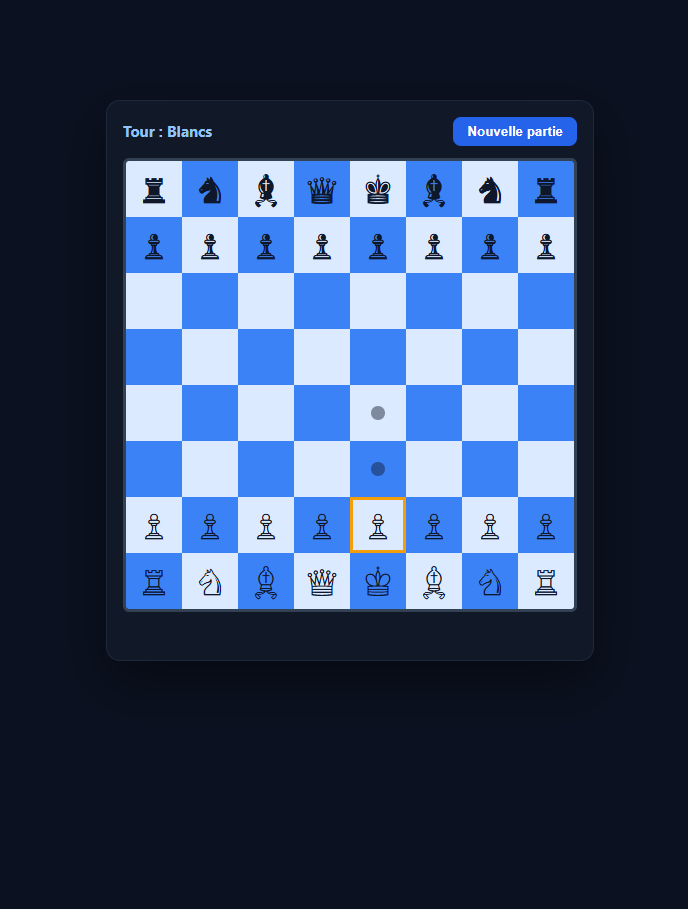

# France Student pour Antigravity (`fs-atg` v2.0.0)

Orchestrateur **France Student** pour Antigravity (panneau latéral + serveur MCP `stdio`) : exécution autonome sur le workspace (`edit_file`, `write_file`, `run_command`) avec **3 modes de permissions**, sauvegarde atomique **`/undo`**, **mémoire projet (`/remember`, `/memory`, `FRST.md`)**, **14 modèles France Student**, routage rapide sans artefact (`enableCanvas: false`) et **jauge unique interactive**.

## Aperçu

| Accueil (Jauge unique, Permissions PC & `/undo`) | Modèles (14 modèles FS, date & badge Nouveau) |
| :---: | :---: |
|  |  |

| Journal de bord (`fs_logs`) | Réglages & Mémoire projet |
| :---: | :---: |
|  |  |

## Nouveautés majeures `v2.0.0`

- **Exécution autonome + Sécurité granulaire (3 modes)** :
  - **Lecture seule (`plan`)** : uniquement `list_directory`, `read_file`, `search_files` (renvoie `/plan` ou `/patch`).
  - **Édition + Undo (`acceptEdits`, défaut)** : France Student lit, crée et modifie directement tes fichiers (`edit_file` / `write_file` atomiques, contrôle de fraîcheur anti-écrasement, protection `.env` / `.git` / symlinks) et ne renvoie à Antigravity qu’un **bilan court (`filesWritten`)**.
  - **Complet + Shell (`full`)** : ajoute `run_command` sans shell (`shell: false`), liste blanche/noire stricte (pas de `rm`, `powershell`, `git push`, `npm publish`, `node -e`), filtrage des secrets d’environnement et compression automatique des sorties de tests (`tap-digest` pour `node --test`).
- **Sauvegarde `/undo` atomique (`fs_undo`)** : pile persistante de 30 restaurations par workspace ; annule en 1 clic dans le panneau (`Annuler (N)`) ou via `/undo` dans le chat.
- **Mémoire projet & Auto-apprentissage (`fs_memory`)** :
  - `/remember` & `/memory` (notes persistantes + pré-prompt par projet/global) + lecture hiérarchique de `FRST.md` / `FRSTCLI.md`.
  - Contexte court automatique (~300–800 car. sans shell : OS, branche Git, `package.json`, 1ᵉʳ niveau) + auto-détection de tes sujets récurrents (≥ 3 mentions).
- **Fiabilité API & Économie maximale** :
  - `enableCanvas: false` systématique + prompt placé *avant* les annexes (`---`) pour préserver le prompt cache et réduire les refus.
  - Cooldown automatique sur `HTTP 429`, priorité à `claude-haiku-5-5` (5–8 s) et `claude-sonnet-5-5`, détection des redirections `create_artifact` & stubs tronqués → bascule automatique vers Claude inline + Plan B (`parts`).
- **Jauge unique interactive & 14 modèles FS uniquement** : une seule barre budget + coupe-circuit déplaçable (`0`–`90 %`), thème bleu/noir pur sans violet, et journal rotatif `fs_logs`.

## Commandes `/` disponibles dans Antigravity (`17` commandes)

| Commande | Outil / Mode | Effet & économie Antigravity |
|---|---|---|
| `/send` | `fs_delegate` (`acceptEdits`/`full`) | Délègue création/modification directe avec `filesWritten` & `/undo` (Antigravity ne lit ni ne recopie les fichiers) |
| `/patch` | `executionMode="patch"` (lecture seule) | Renvoie uniquement les lignes à modifier (**`-94,9 %`** mesurés sur un fichier de `7 273` car.) |
| `/plan` | `executionMode="plan"` (lecture seule) | Plan télégraphique (≤ 15 lignes), `0` écriture disque |
| `/dry-run` | `executionMode="dry-run"` (lecture seule) | Aperçu complet à valider avant application |
| `/mode` | `plan` \| `acceptEdits` \| `full` | Change ou force le mode de permission sur une tâche |
| `/undo` | `fs_undo` (`action="undo"\|"list"`) | Annule atomiquement la dernière modification France Student |
| `/remember` | `fs_memory` (`action="remember"`) | Mémorise une règle/note persistante injectée au 1ᵉʳ tour |
| `/memory` | `fs_memory` (`get` \| `forget` \| `clear` \| `preprompt`) | Consulte, édite ou vide la mémoire et le pré-prompt du projet |
| `/eco`, `/low`, `/fast` | `claude-haiku-5-5` prioritaire (< 10 s) | 1 seul appel MCP court (`~433–683` car.) |
| `/medium` | `claude-sonnet-5-5` prioritaire | Rapide avec outils client et zéro artefact |
| `/high` | Gamme forte (`opus`, `gpt-6.2-astra`, `gpt-6.2-sol`) | Audits, comparatifs, architecture, debug complexe |
| `/new`, `/compact` | `fs_session` | Réinitialise ou compacte la session côté France Student (`/compact` et `/usage` natifs côté Antigravity) |
| `/diagnostics`, `/logs` | `fs_diagnostics`, `fs_logs` | Vérifie clé, API, modèles, quota et journal d'erreurs |

## Quand gagne-t-on vraiment du quota Antigravity ? (expliqué simplement)

- **Avec `v2.0.0` (`acceptEdits` / `full` + `clientTools` actifs)** :
  - **Modifier / créer un fichier ou lancer `node --check` sur ton projet (`fs_delegate` + `workspaceRoot`)** : **OUI — Énorme gain**. France Student lit (`math.mjs`), crée (`greet.mjs`), modifie et vérifie tout seul, et ne renvoie à Antigravity qu’un résumé de **`269` à `299` caractères** (mesuré en live sur MCP : **`3 314` tokens** économisés sur un mini-test). Antigravity ne réécrit plus les fichiers via `write_file`.
- **En mode lecture seule (`plan` / `/patch`)** :
  - **`/patch`** : **`-52,2 %` à `-94,9 %`** de volume à lire et appliquer.
  - **`/plan`** : résumé en **8 à 19 lignes** sans explorer le projet côté Antigravity.
  - **Discuter directement dans le panneau latéral** : **`0` token Antigravity** utilisé.
- **Ce qu’il faut toujours garder en natif Antigravity (`~0 %` ou perte en délégation)** :
  - **Changer moins de 10 lignes** déjà visibles dans l’éditeur.
  - **Faire 1 petite recherche web rapide** (`search_web` natif = 1 étape).

La mesure officielle de consommation Antigravity reste accessible directement via `/usage`.

## Exemples concrets mesurés

| Exemple | Mode utilisé | Résultat mesuré |
|---|---|---|
| **Édition & création autonome (`math.mjs` + `greet.mjs`)** | `v2.0.0` `acceptEdits` (`claude-sonnet-5-5`) | `2` tours d’outils, `2` écritures directes avec `/undo`, résumé renvoyé à Antigravity de seulement **`269` car.** |
| **Vérification syntaxique shell (`node --check`)** | `v2.0.0` `full` (`claude-sonnet-5-5`) | Exécution directe sans shell (`exit=0`, `81 ms`), réponse de **`299` car.** |
| **Patch ciblé sans écriture (`calculator-3d`)** | `/patch` (`claude-sonnet-5-5`) | **`371` car.** renvoyés au lieu de `7 273` (**`-94,9 %`**) |
| **Fonction utilitaire rapide (`formatBytes`)** | `/eco` (`claude-haiku-5-5`) | **`433` car.** en **`7,99 s`** |
| **Générations comparées (mode texte historique v1)** | Calculatrice 3D & Échecs 2D | Calculatrice : Antigravity `7 273` car. vs FS `24 149` car. · Échecs 2D : Antigravity `6 650` car. vs FS `16 970` car. |

| Calculatrice Antigravity vs France Student | Échecs 2D Antigravity vs France Student |
| :---: | :---: |
|   |   |

## Installation rapide

```bash
git clone https://github.com/pierregdc/fs-atg.git
cd fs-atg
node install.mjs
```

Rechargez Antigravity, ouvrez **France Student [ATG]** et renseignez votre clé API ou jeton de session dans **Réglages**.
