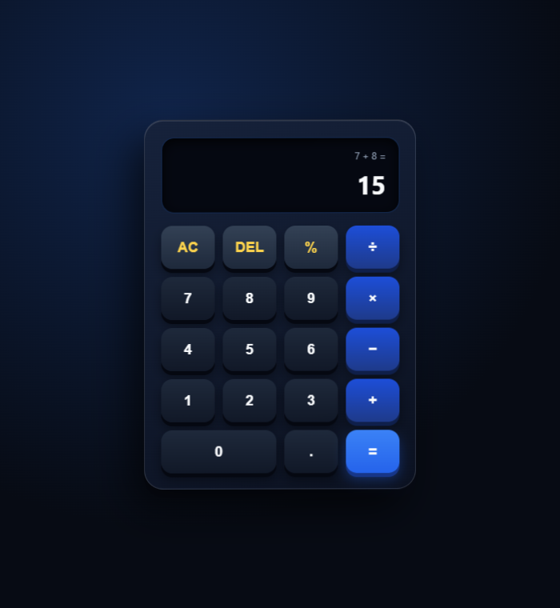

<p align="center">
  <picture>
    <source media="(prefers-color-scheme: dark)" srcset="docs/images/logo-dark.svg">
    <source media="(prefers-color-scheme: light)" srcset="docs/images/logo-light.svg">
    
  </picture>
</p>

<h1 align="center">France Student pour Antigravity (<code>fs-atg</code> v2.1.0)</h1>

<p align="center">
  <strong>Orchestrateur France Student &amp; serveur MCP <code>stdio</code> pour Antigravity</strong><br>
  Exécution autonome sur le workspace, sauvegarde atomique <code>/undo</code>, contrôle par modèle (Oui / À demander / Non), raisonnement boosté et cascade de résilience 502/429.
</p>

<p align="center">
  <a href="plugin/plugin.json"></a>
  <a href="LICENSE"></a>
  <a href="#commandes-slash-officielles"></a>
  <a href="#securite-et-permissions"></a>
</p>

---

## Aperçu de l'interface

L'interface du panneau latéral adopte un thème monochrome/slate et bleu unifié sans surcharge visuelle, structuré en **3 onglets principaux** (**Accueil**, **Modèles**, **Réglages**) avec indicateurs clarifiés : pastilles de gamme (`Fort`, `Équilibré`, `Léger`), badge émeraude `Nouveau` (< 14 jours), barres d'intensité du raisonnement et sélecteur d'autorisation par modèle.

| Accueil (jauge unique, permissions &amp; raisonnement) | Modèles (contrôle Oui / À demander / Non &amp; badges) |
| :---: | :---: |
|  |  |

| Réglages (connexion &amp; comportement) | Journal &amp; Avancé (logs &amp; diagnostics) |
| :---: | :---: |
|  |  |

---

## Nouveautés v2.1

- **Contrôle individuel par modèle (`Oui` / `À demander` / `Non`)** : autorise, bloque ou exige une confirmation utilisateur explicite avant qu'Antigravity ou le panneau n'utilise un modèle.
- **Interface unifiée en 3 onglets** :
  - **Accueil** : jauge unique interactive (budget chat restant + coupe-circuit réglable de 0 % à 90 %), sélecteurs compacts *Délégation* et *Permissions PC*, barre de commandes rapides (`/fs`, `/max`, `/patch`, `/plan`, `/eco`, `/remember`), sélecteur de raisonnement à 3 niveaux (*Standard*, *Approfondi*, *Maximum*) et historique détaillé avec `/undo`.
  - **Modèles** : catalogue filtrable avec fournisseur, fenêtre de contexte, date de détection, badge `Nouveau` (< 14 jours) et contrôle 3 états sur chaque carte.
  - **Réglages** : sous-onglets *Essentiel*, *Mémoire* (`FRST.md`, notes, pré-prompt) et *Journal &amp; Avancé* avec badge d'erreurs sur l'onglet.
- **Cascade de résilience 502/429 &amp; Cooldown `IA non dispo`** : en cas d'erreur HTTP 502, 503, 504 ou 429, bascule automatique du meilleur modèle au moins fort (`heavy` -> `medium` -> `light`). Si aucun modèle autorisé ne répond, un **cooldown global de 10 minutes (`IA non dispo`)** est activé pour laisser Antigravity travailler en natif sans blocage.
- **8 commandes slash officielles** déclarées dans `plugin/skills/` pour le chat Antigravity.

---

## Contrôle par modèle (Oui / À demander / Non)

Dans l'onglet **Modèles**, chaque modèle dispose d'un sélecteur persistant (`.fsatg_state.json`) qui gouverne à la fois le serveur MCP (`fs_delegate`) et les générations du panneau :

| État | Valeur | Comportement sur le routage, `fs_delegate` et la cascade 502/429 |
| :--- | :--- | :--- |
| **Oui** | `allow` | Utilisable librement par le routeur et par les replis automatiques. |
| **À demander** | `ask` | Si le modèle est choisi ou recommandé, `fs_delegate` retourne `status: "needs_approval"` avec jusqu'à 3 alternatives en `Oui` : Antigravity demande confirmation à l'utilisateur avant de relancer avec `approveModel`. Exclu des bascules silencieuses de la cascade 502/429. |
| **Non** | `deny` | Totalement exclu du routage automatique, de la cascade de secours et des sélections explicites (`Utiliser` masqué, erreur explicite en cas d'appel direct). |

---

## Commandes slash officielles

| Commande | Outil / Paramètre | Effet et économie de quota Antigravity |
| :--- | :--- | :--- |
| **`/fs`** | `fs_delegate` (`workspaceRoot`) | Délégation principale avec lecture/écriture directe sur disque et sauvegarde `/undo` ; seul un bilan court (`filesWritten`) revient à Antigravity. |
| **`/max`** | `reasoningEffort="max"` | Active le protocole de raisonnement maximal et priorise les modèles `Fort`. |
| **`/patch`** | `executionMode="patch"` | Mode lecture seule : renvoie uniquement les blocs `TARGET` / `REPLACE` à appliquer (**-94,9 %** mesurés). |
| **`/plan`** | `executionMode="plan"` | Mode lecture seule : plan d'action télégraphique (<= 15 lignes), zéro écriture disque. |
| **`/eco`** | `routingProfile="eco"` | Profil rapide économe : privilégie les modèles `Léger` (`< 10 s`). |
| **`/undo`** | `fs_undo` | Restaure atomiquement la dernière écriture ou création de fichier de France Student. |
| **`/remember`** | `fs_memory` | Enregistre une règle ou note persistante injectée automatiquement au 1er tour (`FRST.md` + mémoire projet). |
| **`/quota`** | `fs_quota` + `fs_diagnostics` | Affiche le quota restant, l'état du cooldown `IA non dispo`, les modèles disponibles et le diagnostic API. |

---

## Sécurité et permissions

Trois modes de permission PC encadrent les outils locaux de France Student :

- **`plan` (Lecture seule)** : autorise uniquement `list_directory`, `read_file` et `search_files` (idéal pour `/plan` et `/patch`).
- **`acceptEdits` (Édition + Undo, défaut)** : autorise `edit_file` et `write_file` atomiques avec contrôle de fraîcheur anti-écrasement, protection `.env` / `.git` / liens symboliques et pile de restauration `/undo` (jusqu'à 30 entrées par workspace).
- **`full` (Complet + Shell)** : ajoute `run_command` sans interpréteur shell (`shell: false`), filtrage des variables d'environnement sensibles et blocage des commandes destructrices.

---

## Comparatifs mesurés

| Exemple de tâche | Mode &amp; Modèle | Résultat mesuré |
| :--- | :--- | :--- |
| **Édition et création autonome (`math.mjs` + `greet.mjs`)** | `acceptEdits` (`claude-sonnet-5-5`) | 2 tours d'outils, bilan de **269 caractères** envoyé à Antigravity (**3 314 tokens** économisés). |
| **Vérification syntaxique directe (`node --check`)** | `full` (`claude-sonnet-5-5`) | Exécution sans shell (`exit 0`, 81 ms), réponse de **299 caractères**. |
| **Patch ciblé sans écriture (`calculator-3d`)** | `/patch` (`claude-sonnet-5-5`) | **371 caractères** transférés au lieu de 7 273 (**-94,9 %**). |
| **Utilitaire court (`formatBytes`)** | `/eco` (`claude-haiku-5-5`) | **433 caractères** en **7,99 s**. |

| Calculatrice 3D (Antigravity vs FS) | Jeu d'Échecs 2D (Antigravity vs FS) |
| :---: | :---: |
|   |   |

---

## Installation

```bash
git clone https://github.com/pierregdc/fs-atg.git
cd fs-atg
node install.mjs
```

1. Rechargez Antigravity puis activez l'extension **France Student [ATG]**.
2. Ouvrez le panneau latéral et renseignez votre clé API ou jeton de session dans **Réglages -> Essentiel**.
3. Ajustez vos permissions et le contrôle **Oui / À demander / Non** de chaque modèle dans l'onglet **Modèles**.
