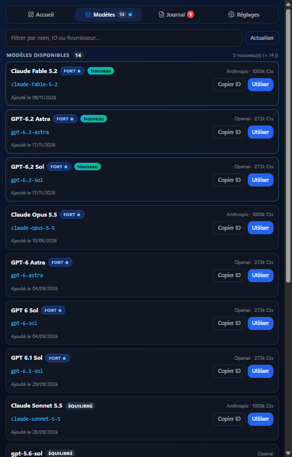

# France Student pour Antigravity (`fs-atg` v0.7.0)

Plugin Antigravity (panneau latéral + serveur MCP) pour déléguer plans, diagnostics, recherches multi-sources et blocs de code ciblés aux **14 modèles France Student**, en mode **lecture seule sur le PC**.

## Aperçu

| Accueil (Jauge unique, Auto/Manuel & Profil) | Modèles (14 modèles FS, date & badge Nouveau) |
| :---: | :---: |
|  |  |

| Journal de bord (`fs_logs`) | Réglages |
| :---: | :---: |
|  |  |

## Nouveautés & fonctionnalités clés

- **Jauge unique interactive (`Accueil`)** : une seule barre regroupe le **budget chat restant** (bleu/noir, sans violet) et le **curseur du coupe-circuit** déplaçable directement à la souris ou au clavier (`0`–`90 %`, raccourcis `0%` `10%` `15%` `25%`), avec sélecteur de profil et mode `Auto / Manuel` sur la même vue.
- **14 modèles France Student uniquement** : catalogue synchronisé avec `/v1/models` (ID copiable, date d'ajout réelle et badge `Nouveau` < 14 jours) ; priorité aux modèles fiables et **bascule automatique vers Claude (`claude-sonnet-5-5`)** si un modèle tente une redirection `create_artifact` sans code inline.
- **Prompts & réponses ultra-compacts** : consignes sans texte superflu ni commentaires inutiles, plans télégraphiques en 15 lignes max, et calcul d'économie nette réaliste dans `Éco. ATG` (qui déduit le coût de lecture côté Antigravity).
- **Lecture seule sur le PC** : France Student n'écrit jamais sur le disque ; il renvoie le résultat dans `response`.
- **Plan A + Plan B** : réessai automatique sur session isolée ou découpage en petits blocs (`planB: true`, `parts: [...]`).
- **Journal de bord (`fs_logs`)** : logs rotatifs filtrables conservant les compteurs numériques `usage` tout en masquant clés API et jetons.

## Commandes `/` disponibles dans Antigravity

| Commande | Action / Routage | Objectif économie Antigravity |
|---|---|---|
| `/patch` | `executionMode="patch"` + lecture `files` côté MCP | Renvoie uniquement des paires `TARGET` / `REPLACE` pour `edit_file` (**-52 % à -70 %** mesurés) |
| `/plan` | `executionMode="plan"` (≤ 15 lignes) | Plan télégraphique sans code ni écriture disque |
| `/eco`, `/fast`, `/low` | `claude-haiku-5-5` / modèles rapides (< 15 s) | Finir en **1 seul appel MCP**, moitié moins de texte lu par Antigravity |
| `/medium` | `claude-sonnet-5-5` prioritaire | Code inline dense sans redirection `create_artifact` |
| `/high` | Gamme forte (`opus`, `gpt-6.2-astra`, `gpt-6.2-sol`) | Architecture, audits, debug ou logique complexe |
| `/send`, `/dry-run` | Délégation directe / aperçu sans écriture | Blocs ciblés ou proposition à valider (`files` lus côté MCP) |
| `/new`, `/compact` | Session persistante France Student (`fs_session`) | Repartir à zéro ou compacter le contexte côté France Student (`/usage` & `/compact` côté Antigravity) |
| `/diagnostics`, `/logs` | Lecture seule état & journal rotatif (`fs_logs`) | Contrôle clé/API/modèles/quota et suivi d'erreurs |

## Quand déléguer pour économiser vraiment ?

- **Gain réel élevé (~50 % à 80 %)** : plans d'architecture, revues de code, audits multi-fichiers, comparatifs multi-critères, débogage et fonctions/patches ciblés.
- **À garder en natif (~0 % de gain en délégation)** : micro-éditions (`< 10` lignes), **1 recherche `search_web` ponctuelle**, ou génération complète d'un gros fichier neuf si Antigravity doit ensuite tout réécrire ligne par ligne via `write_file`.
- La mesure officielle de consommation Antigravity reste accessible directement via `/usage`.

## Installation rapide

```bash
git clone https://github.com/pierregdc/fs-atg.git
cd fs-atg
node install.mjs
```

Rechargez Antigravity, ouvrez **France Student [ATG]** et renseignez votre clé API ou jeton de session dans **Réglages**.
