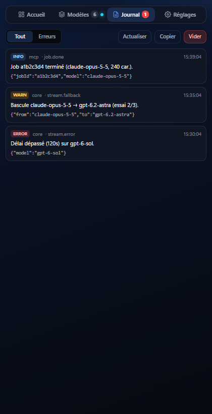

# France Student pour Antigravity (`fs-atg` v0.7.0)

Plugin Antigravity (panneau latéral + serveur MCP) pour déléguer la génération de code et les réponses aux modèles **France Student** tout en économisant **70 % à 90 %** des tokens Antigravity.

## Aperçu

| Accueil (Auto / Manuel & Historique) | Modèles (ID, date & badge Nouveau) |
| :---: | :---: |
|  |  |

| Journal de bord (`fs_logs`) | Réglages |
| :---: | :---: |
|  |  |

## Fonctionnalités principales

- **Lecture seule sur le PC** : France Student n'écrit jamais sur le disque ; il renvoie le code/texte dans `response`, qu'Antigravity copie, applique ou complète.
- **Modèles forts prioritaires** : routage par défaut sur la classe forte (`claude-opus-5-5`, `claude-fable-5-2`, `gpt-6.2-astra`, `gpt-6.2-sol`, `gpt-6-astra`, `gpt-6.1-sol`, `gpt-6-sol`) avec repli automatique jusqu'à 3 modèles.
- **Plan A + Plan B** : bascule automatique sur session isolée ou découpage en petits blocs (`planB: true`, `parts: [...]`) en cas d'échec.
- **Mode Automatique / Manuel** : interrupteur en 1 clic dans le panneau (`Automatique` par défaut ou `Manuel` sur commande `/send`, `/plan`, `/high`, `/logs`, etc.).
- **Onglet Modèles & Journal de bord** : liste des modèles (ID copiable, date d'ajout, badge `Nouveau` < 14 jours) et logs rotatifs (`fs_logs`) avec masquage des secrets.

## Installation rapide

```bash
git clone https://github.com/pierregdc/fs-atg.git
cd fs-atg
node install.mjs
```

Rechargez Antigravity, ouvrez **France Student [ATG]** et renseignez votre clé API ou jeton de session dans **Réglages**.
