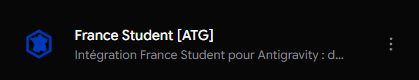
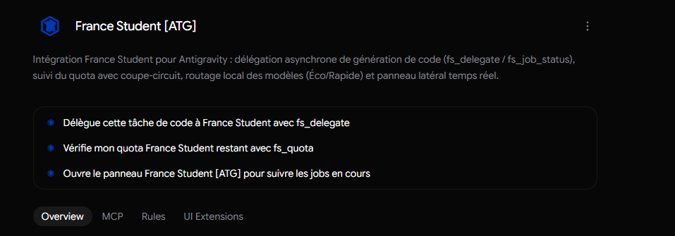
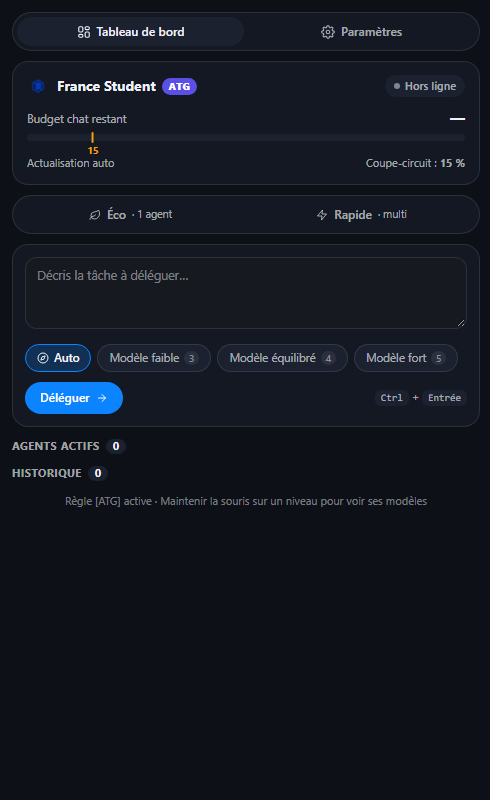
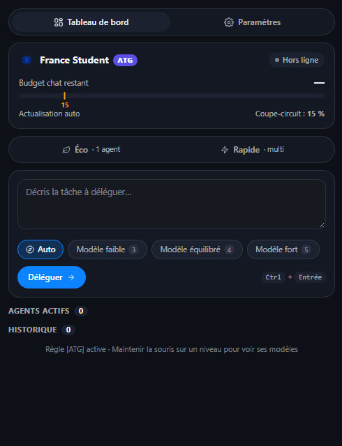
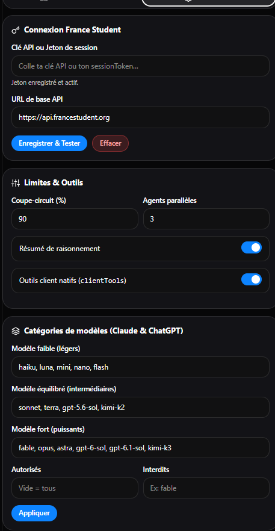
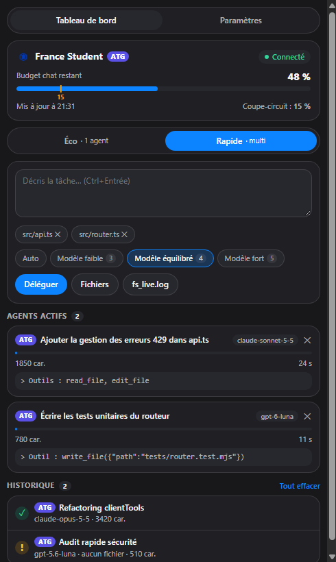
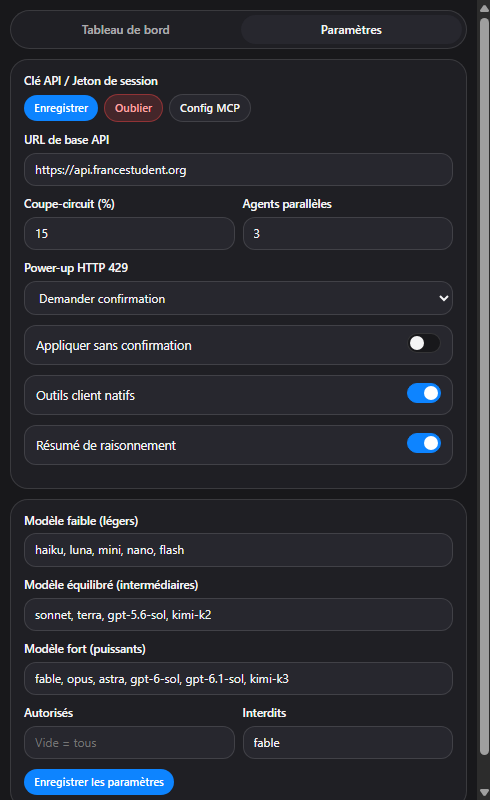

# France Student pour Antigravity (`fs-atg`)

Extension IDE (`.vsix`) et plugin Antigravity (panneau latéral + serveur MCP + règle par défaut) pour déléguer la génération de code aux modèles **France Student** (ChatGPT & Claude).

## Aperçu

Les captures sont illustratives. Dans le panneau exécuté, les modèles, le quota et
l'état de connexion ne sont affichés comme données de compte qu'après vérification
auprès du fournisseur.

### Antigravity (Plugin & Side Panel)

| Carte du plugin | Vue d'ensemble du plugin |
| :---: | :---: |
|  |  |

| Tableau de bord | Agents actifs & Historique |
| :---: | :---: |
|  |  |

| Liste des modèles (survol) | Paramètres |
| :---: | :---: |
|  |  |

### Antigravity IDE / VS Code (Extension `.vsix`)

| Exécution multi-agents & fichiers joints | Paramètres IDE & MCP |
| :---: | :---: |
|  |  |

## Installation rapide (Antigravity)

```bash
git clone https://github.com/pierregdc/fs-atg.git
cd fs-atg
node install.mjs
```

Rechargez Antigravity, ouvrez **Extensions > France Student [ATG]**, puis dans **Paramètres** collez votre **clé API** (ou votre cookie `next-auth.session-token` de `ia.francestudent.org` en attendant l'accès développeur).

### Clé et stockage local

Le champ de clé reste volontairement vide après l’enregistrement : il est masqué,
pas effacé. Dans l’extension IDE, VS Code utilise son `SecretStorage`. Dans le
plugin Antigravity sous Windows, une ancienne clé stockée dans le fichier d’état
est migrée vers le Gestionnaire d’identifiants Windows seulement après écriture,
relecture de vérification et sauvegarde de l’état. Si une de ces étapes échoue,
la valeur legacy est conservée. L’interface affiche uniquement l’état
« configurée » et son type de stockage, jamais la clé.

<details>
<summary>Installation manuelle (sans script)</summary>

1. Copiez `plugin/` dans `~/.gemini/config/plugins/fs-atg/`.
2. Dans `~/.gemini/config/plugins/fs-atg/mcp_config.json`, remplacez `<HOME>` par le chemin absolu de votre dossier utilisateur.
3. Installez les dépendances : `cd ~/.gemini/config/plugins/fs-atg && npm install --omit=dev`.

</details>

<details>
<summary>Optionnel : installer aussi l'extension .vsix dans Antigravity IDE / VS Code</summary>

```bash
npm install && npm run build
npx @vscode/vsce package --allow-missing-repository
```
Installez ensuite le `.vsix` généré via **Extensions → Install from VSIX…**.
Le paquet contient aussi le dossier `plugin/` : exécutez son `install.mjs` depuis
le dossier de l’extension si vous devez installer le panneau Antigravity sur une
autre machine.

</details>

## Gains estimés (honnêtes)

- **Contexte de l'agent principal** : quand les `clientTools` sont utilisés, les fichiers sont lus et écrits directement dans le workspace, sans repasser par la conversation principale. Le gain dépend donc réellement de la taille et du nombre de fichiers concernés.
- **Consommation réelle** : la génération consomme malgré tout votre **quota France Student** (d'où le coupe-circuit configurable, défaut `15 %`).
- **Routage à 0 token** : le choix `Modèle faible` / `Modèle équilibré` / `Modèle fort` est 100 % local (aucun appel API de tri).
- **Chat direct persistant** : un chat France Student est conservé par workspace. Après le premier tour, l’extension envoie seulement la nouvelle demande (`POST /chats/{chatId}`), puis compacte automatiquement le contexte à 80 % par défaut.
- **Contexte ciblé** : avec `clientTools`, les fichiers joints sont transmis comme chemins ; le modèle lit seulement les plages utiles au lieu de recevoir tout le document.
- **Suites compactes** : dans une session persistante, les suites ne renvoient aucun résumé ; sans session, elles ne transmettent que le résumé du job précédent, jamais son code complet.
- **Index intelligent borné** : le mode `smart` ajoute au plus un petit index de chemins, symboles et imports locaux ; il ne joint pas le contenu des fichiers.
- **Diff conditionnel** : lorsque les outils client ne sont pas disponibles mais qu’un chat persistant possède déjà une base de fichier en mémoire, l’intégration peut transmettre un patch plus court. Elle renvoie le fichier complet dès qu’un diff serait ambigu, plus long, ou que le chat n’est pas persistant.

### Contrôle du contexte et commandes natives Antigravity

Le mode par défaut est **Minimal** : seule la nouvelle demande est envoyée. Avec un chat persistant, France Student garde le contexte de son côté ; Antigravity ne relit ni ne recopie les documents. Les modes **Ciblé** (chemins sélectionnés) et **Intelligent** (index borné de chemins, symboles et imports, sans contenu) restent disponibles quand ils sont utiles.

Les commandes sont maintenant proposées dans le menu `/` du chat Antigravity, comme les commandes natives `gdrive` ou `gmail`. Elles utilisent des noms courts :

| Commande native | Action locale |
| --- | --- |
| `/send` | Déléguer la demande |
| `/plan`, `/dry-run` | Plan sans écriture ou proposition révisable |
| `/low`, `/medium`, `/high` | Préférer un modèle léger, équilibré ou puissant |
| `/eco`, `/fast` | Choisir le profil de routage Éco ou Rapide |
| `/new`, `/compact`, `/diagnostics` | Gérer la session ou contrôler l'état en lecture seule |

Le panneau latéral ne propose plus d'autocomplétion de commandes : il sert au suivi, aux diagnostics, au choix ponctuel de modèle et à la délégation manuelle. Les commandes courtes sont retirées avant l'appel à France Student. Les anciens alias avancés restent compris uniquement pour compatibilité, mais ne sont pas affichés dans le menu.

- `/plan` analyse et retourne un plan sans écrire ; `/dry-run` prépare des fichiers proposés sans les appliquer. Les deux retirent localement les outils d’écriture, même si un fournisseur retournait un appel outil inattendu.
- Les profils ne prétendent pas refléter les droits ou la disponibilité du compte ; ils choisissent seulement une préférence de gamme parmi les modèles déjà autorisés.
- `/new` repart sur une nouvelle session persistante ; `/compact` demande une compaction immédiate.
- Le panneau affiche séparément l’estimation locale de prompt avant envoi et l’usage fournisseur seulement lorsque celui-ci est présent dans la réponse API. Une estimation n’est jamais présentée comme une consommation facturée.

## Fonctionnalités clés

- **Double mode** : Clé API (`/v1/responses`) ou `sessionToken` (`/chats/stream` + `clientTools`).
- **Disponibilité des modèles vérifiée** : le panneau ne présente une liste de modèles comme disponible qu'après une réponse du fournisseur. Les profils locaux ne servent qu'au routage de secours et ne sont jamais affichés comme l'état du compte.
- **Refus de modèle traçables** : après un refus déclaré par le fournisseur, une seule reprise peut être tentée avec un autre modèle autorisé de la même gamme, dans un chat neuf. Le motif retourné est conservé ; il n'y a ni reprise en boucle, ni reprise après une écriture locale, une annulation ou une erreur réseau.
- **Historique clair** : `✓` fichiers écrits, `!` terminé sans écriture, `✕` erreur.
- **Revue avant écriture** : un `/dry-run` peut produire un diff local, puis une action explicite d’application. L’annulation vérifie que les fichiers n’ont pas changé depuis l’application ; elle refuse d’écraser une modification plus récente.
- **Diagnostics explicites** : le panneau et MCP indiquent l’état observé de la clé, du dernier contrôle API, des modèles, du quota, des slots et de la session. Ils n’affichent pas une valeur inconnue comme une donnée vérifiée.
- **Sécurité** : accès limité au workspace (`.git/` et `.env*` bloqués, sans exécution shell par défaut).
- **Catalogue API sobre** : `fs_catalog` découvre les modèles, capacités, Skills, Projects, MCP distants et fichiers v2 en lecture seule, avec une sortie bornée.
- **Flux résilient** : en cas de coupure SSE, le chat se rattache une fois avec `Last-Event-ID` sans renvoyer la demande complète.

### Revue locale et rétention

Pour rendre un `/dry-run` applicable puis annulable dans le plugin, les versions
« avant » et « proposées » de fichiers texte sont gardées localement dans
`.fsatg_reviews` pendant au plus 24 heures, avec une limite de taille par revue.
Ces snapshots peuvent donc contenir du code du workspace : ils ne sont ni envoyés
au catalogue API ni affichés dans le panneau. Supprimez-les si vous ne voulez pas
conserver cette possibilité d’annulation. L’extension IDE utilise pour sa part un
journal en mémoire, perdu au redémarrage, et l’indique comme tel.

### Vérification contractuelle de l’API

Le probe optionnel `npm run test:api-contract` vérifie en lecture seule les
formats d’endpoints effectivement consommés par l’intégration. Il exige un jeton
fourni explicitement via `FS_ATG_CONTRACT_TOKEN`, ne lit pas le fichier d’état et
n’affiche pas le secret. Voir [la procédure détaillée](docs/API_CONTRACT_TESTS.md).
